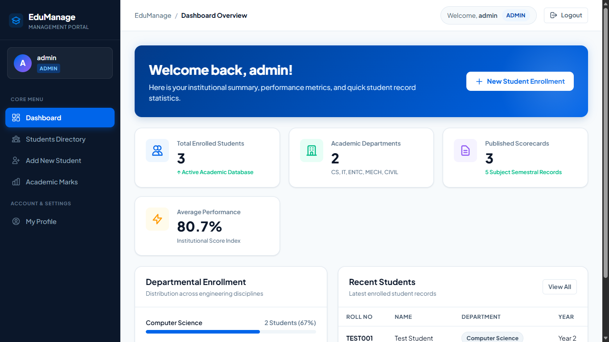
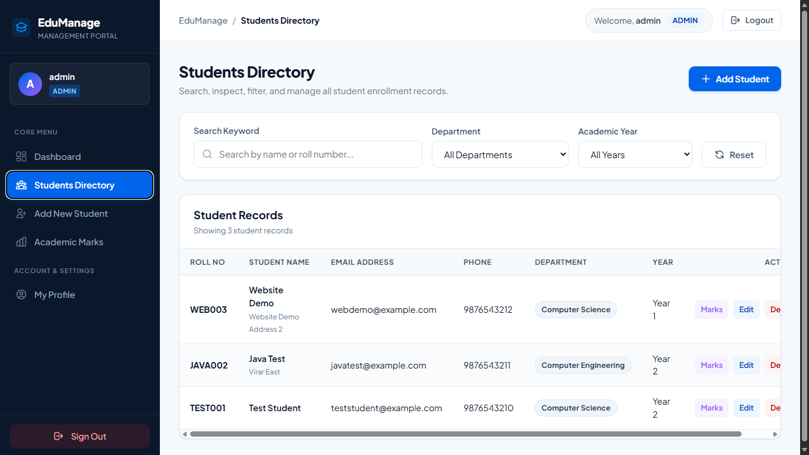
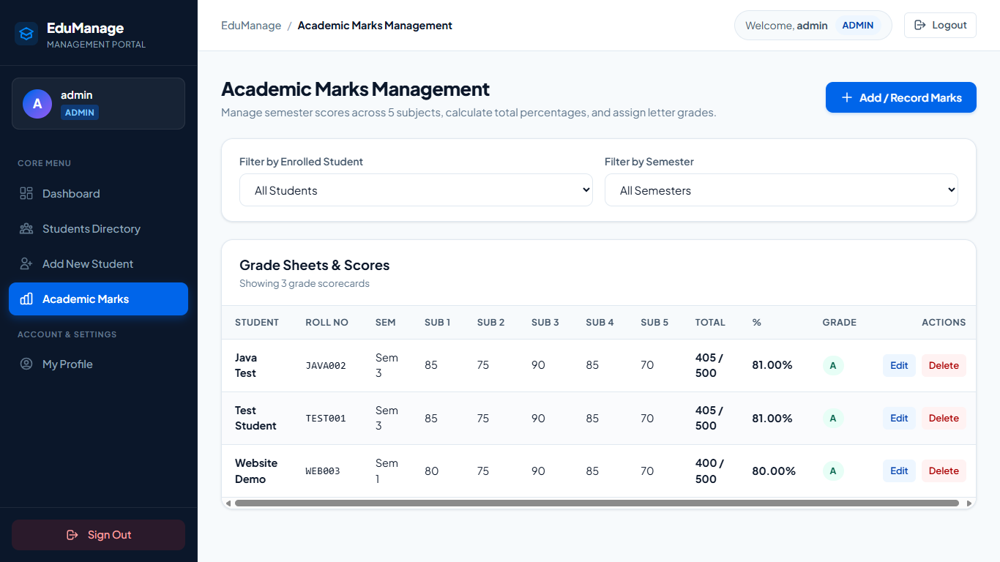
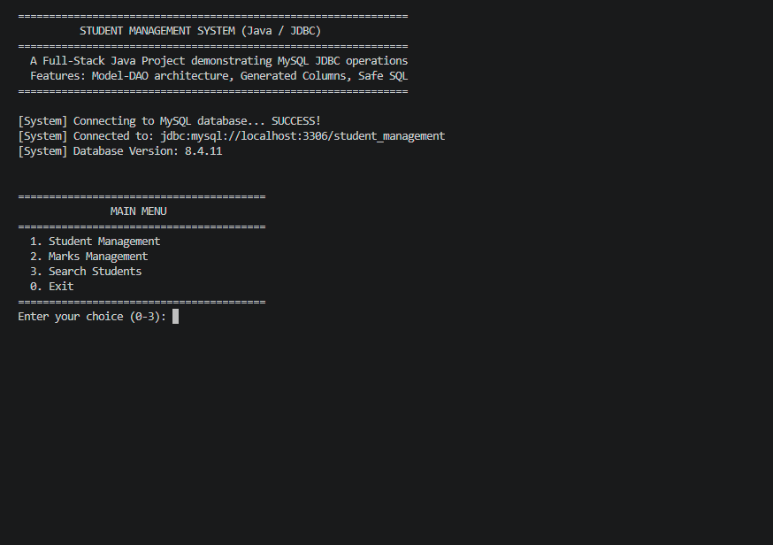
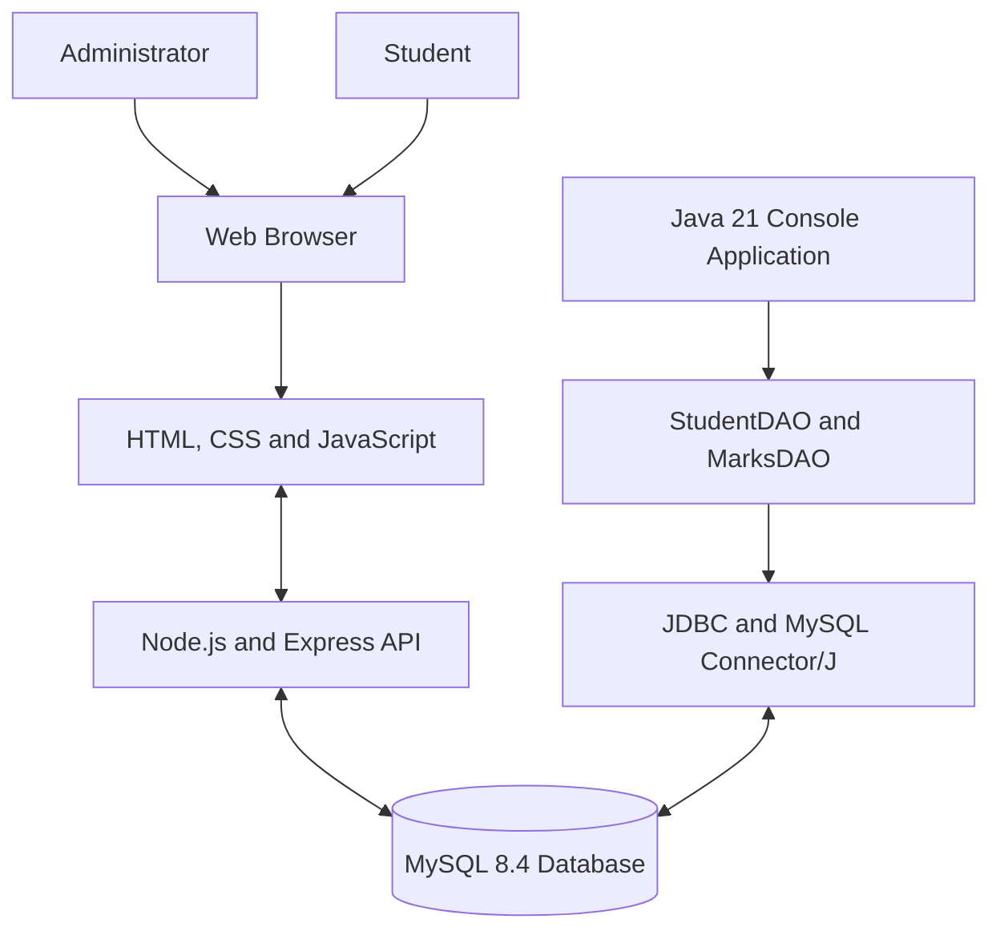

<div align="center">

# EduManage Global

### Student Information & Academic Records Platform

A unified student management system connecting a web application and a Java console application through a shared MySQL database.

[Explore Repository](https://github.com/Rudra070707/EduManage-Global) · [Report an Issue](https://github.com/Rudra070707/EduManage-Global/issues)


</div>

---

## Overview

EduManage Global is a student information and academic records platform designed to bring student administration and academic performance tracking into one shared database.

The platform combines two applications:

- **Web application (WD):** A browser-based interface for student records, academic marks, dashboards, and role-based access.
- **Java application (FSJP):** A menu-driven console application built with Java and JDBC for student and marks management.

Both applications connect to the same MySQL database. Changes made through one application can be viewed through the other when they access the same records.

> **Project status:** Active development. This is an educational software project and is not yet production-ready.

## Product screenshots

Explore the actual EduManage Global interfaces.

### 1. Admin dashboard

An overview of student records and academic management.



### 2. Student directory

Browse and manage student records through the web interface.



### 3. Academic marks

View student marks, subject scores, totals, percentages, and grades.



### 4. Java console application

The Java/JDBC application connects to the same MySQL database as the web application.



## Product capabilities

| Area | Capabilities |
|---|---|
| Identity and access | Administrator and student accounts, server-side sessions, and role-based permissions |
| Student administration | Student enrolment, directory, search, filtering, profile updates, and record management |
| Academic records | Five-subject scorecards, totals, percentages, and letter grades |
| Student experience | Personal dashboard, profile details, and academic results |
| Java application | JDBC connectivity, DAO-based database access, student operations, and marks management |
| Shared database | Both applications use the `student_management` MySQL database |
| Automated testing | Jest and Supertest tests for application responses, authorization, and marks validation |

## System architecture



### Key architectural characteristics

- **Shared data:** Both applications access the same MySQL database, allowing changes to shared records to be reflected across the applications.
- **Separation of concerns:** The web application uses an Express backend, while the Java application separates database operations through DAO classes.
- **Database-generated values:** The marks table uses generated columns for calculated academic values where defined in the database schema.
- **Relational integrity:** Database constraints help maintain relationships between student records and associated academic records.

## Technology stack

### Web application

- HTML5, CSS3, and vanilla JavaScript
- Node.js and Express.js
- MySQL access through `mysql2`
- `express-session` with a MySQL-backed session store
- `bcrypt` for password hashing
- Jest and Supertest for automated testing

### Java application

- Java 21
- Java Database Connectivity (JDBC)
- MySQL Connector/J
- DAO-based database access
- Java model classes for student and marks records

### Database

- MySQL Server 8.4
- Relational tables for users, students, marks, and sessions
- Generated total and percentage fields for academic scores

## Verification and testing

The following checks have been completed in the current development environment:

| Verification | Result |
|---|---|
| Java compilation | Passed |
| Java JDBC connection to MySQL | Passed |
| Student records accessed through both applications | Verified |
| Marks records accessed through both applications | Verified |
| Java marks update reflected in the web application | Verified |
| Node.js automated tests | 47 passed across 4 suites |
| Web backend MySQL connection | Verified |
| MySQL session store initialization | Verified |

The automated tests cover application responses, authentication requirements, role-based access, and marks validation.

These results describe the tested development environment. They do not imply production certification, exhaustive test coverage, or a complete security audit.

## Repository structure

```text
EduManage-Global/
├── assets/
│   └── screenshots/
│       ├── admin-dashboard.png
│       ├── student-directory.png
│       ├── academic-marks.png
│       └── java-console.png
├── database/
│   ├── schema.sql
│   └── sample-data.sql
├── docs/
│   ├── setup-guide.md
│   └── viva-questions.md
├── fsjp/
│   ├── lib/
│   ├── src/main/java/com/studentmgmt/
│   ├── db.properties.example
│   └── README.md
├── wd/
│   ├── backend/
│   ├── public/
│   ├── tests/
│   ├── package.json
│   └── package-lock.json
├── .gitignore
└── README.md
```

## Getting started

### Prerequisites

- Node.js and npm
- MySQL Server 8.4
- JDK 21
- MySQL Connector/J for the Java application
- PowerShell or another terminal

### 1. Clone the repository

```powershell
git clone https://github.com/Rudra070707/EduManage-Global.git
cd EduManage-Global
```

### 2. Configure the database

Start MySQL and ensure that the `student_management` database and required tables exist.

The schema definition is available in [`database/schema.sql`](database/schema.sql).

Review [`database/sample-data.sql`](database/sample-data.sql) before running it. It is intended for a demonstration database and must not be run blindly against an existing working database.

For detailed instructions, see the [setup guide](docs/setup-guide.md).

### 3. Configure and start the web application

Open PowerShell from the project root:

```powershell
cd wd
npm.cmd install
```

Create a local `.env` file using `.env.example` as a reference. Configure the required database settings and a strong session secret using the variable names expected by the backend.

Keep `.env` private. Never commit database passwords or session secrets.

Start the development server:

```powershell
npm.cmd run dev
```

Open the application in your browser:

**http://localhost:3000**

### 4. Configure and run the Java application

Open a separate PowerShell terminal from the project root:

```powershell
cd fsjp
```

Configure `db.properties` using `db.properties.example` as a reference. Enter the credentials for your local database account. Do not commit the real properties file.

Ensure the MySQL Connector/J JAR exists at the expected library path, then compile the Java sources:

```powershell
javac -cp ".\lib\mysql-connector-j.jar" -d .\out .\src\main\java\com\studentmgmt\*.java
```

Run the application:

```powershell
java -cp ".\out;.\lib\mysql-connector-j.jar" com.studentmgmt.App
```

See [`fsjp/README.md`](fsjp/README.md) for the Java application's setup instructions.

### 5. Run automated tests

From the `wd` directory:

```powershell
npm.cmd test
```

The test suite uses Jest and Supertest.

## Security and deployment status

EduManage Global is currently intended for local development and academic demonstration.

Before deploying it to a public environment:

- Replace demonstration credentials and use strong, unique passwords.
- Keep `.env`, `db.properties`, database backups, and other secrets out of Git.
- Use a dedicated database account with least-privilege permissions.
- Configure HTTPS and production cookie settings.
- Review session management, login rate limiting, CSRF protection, and authorization.
- Verify that students can access only their own records.
- Test database backup restoration and application recovery.
- Review dependency vulnerabilities and deployment configuration.

Refer to the setup documentation and source code for implementation details and known limitations.

## Development roadmap

- [x] Web application and Java console application
- [x] Shared MySQL database connectivity
- [x] Student and marks management workflows
- [x] Role-based access controls
- [x] Automated backend test suites
- [x] Product screenshots and repository documentation
- [ ] Expand end-to-end and cross-application integration tests
- [ ] Add continuous integration for automated test execution
- [ ] Improve deployment documentation and operational monitoring
- [ ] Complete a production-focused security review

## Documentation

- [Setup guide](docs/setup-guide.md)
- [Java application guide](fsjp/README.md)
- [Database schema](database/schema.sql)
- [Demonstration data](database/sample-data.sql)
- [Viva questions](docs/viva-questions.md)

## Contributing

Bug reports, improvement suggestions, and contributions are welcome.

1. Fork the repository.
2. Create a focused branch for your change.
3. Run the relevant tests.
4. Submit a pull request describing the change and how it was verified.

## License

No open-source license has been declared yet. Until a license is added, reuse and redistribution remain subject to applicable copyright rules.

---

<div align="center">

**EduManage Global**

*One student database. Two applications. A shared academic record.*

Built as an educational software engineering project.

</div>
